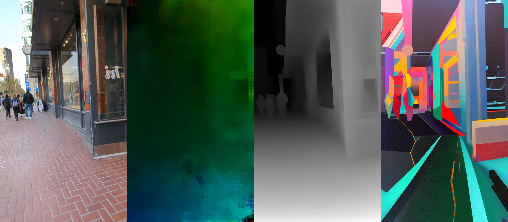
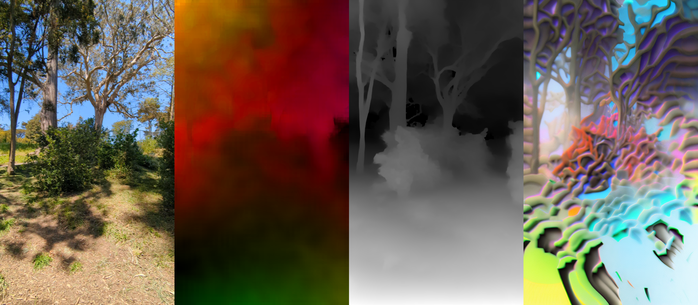

# controlnetvideo
#### Stable Diffusion Video2Video with Feedback

<!-- This is a small command line tool which can apply Stable Diffusion models to a video
while attempting to maintain frame-to-frame consistency.	It is based on the img2img pipeline,
using controlnet with various preproccessors to rerender the input video, and adds a dense
optical flow motion estimator to transfer motion from the input video to the output before feeding
it back into the img2img pipeline as the initial latent.

- Victor Condino <un1tz3r0@gmail.com>, May 21 2023 -->

This python script is a command line tool for rerendering videos with stable diffusion
models, making use of huggingface diffusers library and various other open source projects.
It attempts to solve the problem of frame-to-frame consistency by various methods, primarily
motion transfer from dense optical flow of the input to the output, fed back either using
controlnets or reference only attention coupling.

This is not the right way to do this,
clearly the models need to be extended to allow temporal information passing between frames
and trained on video datasets, which, in the time since this scripts first incarnation, has
proven very effective. I maintain this script and the techniques it uses as a curious and
aesthetically interesting aside. Enjoy

by Victor Condino <un1tz3r0@gmail.com>, Oct 17 2024

---

#### New! Features

- **SDXL ControlNet-Union** (`--controlnet unionxl`) — one model, `--control-type depth|canny|openpose|softedge|normal`
- **IP-Adapter feedback** (`--ip-adapter`) — inject the motion-warped previous frame as an image prompt (modern replacement for reference-only)
- **SDXL Reference-Only (ADAIN)** (`--controlnet refxl`) and **depth ControlNet** (`--controlnet depthxl`)
- **Flux.1** with canny controlnet (`--controlnet fluxcanny`)
- **Animatable video-filter chains** at six points in the pipeline (input / feedforward / motion / control / feedback / output) — see [Video filters](#video-filters)
- **Pluggable motion estimation** (`--motion-estimator raft|raft_small|farneback|dis`) with edge-preserving + occlusion-aware flow smoothing
- Music-video *beat-synced animation* with *piecewise cubic spline curves*, and a **cached** beat analysis (`<audio>.jsonl`, with per-beat/per-bar RMS intensity)

The animation system can sync parameter modulations to the beat of an audio file. It uses [madmom](https://github.com/CPJKU/madmom) to analyze the audio (results are cached next to the file as `.jsonl` so re-runs skip the slow analysis), and lets you specify piecewise cubic bezier curves to modulate parameters in time with the detected downbeats.

> **Legacy note (v0.3.x):** the old per-type SD1.5/SD2.1 controlnet options (`canny`, `depth21`, `openpose`, `hed`, `mlsd`, `normal`, `aesthetic`, …) were removed — they are superseded by `unionxl`, which provides depth/canny/openpose/softedge/normal on SDXL from a single model.

#### Examples of `--animation-params ...` and `--audio-from ...`

```sh
controlnetvideo.py \
	~/Downloads/PXL_20240922_094238715.TS.mp4 \
	outw.mp4 \
	--prompt "by takashi murakami" \
	--dump-frames progress.png \
	--show-input \
	--show-output \
	--show-motion \
	--color-info \
	--motion-sigma 3.0 \
	--motion-alpha 0.5 \
	--color-fix none \
	--feedthrough-strength 0.00 \
	--init-image-strength 0.35 \
	--controlnet refxl \
	--swap-images \
	--audio-from "laundry shuffle short vers 2024-10-17 0433.flac" \
	--audio-animate "feedthrough=L 0 0.8 L 1/32 0.8 L 1/16 0.0 L 1 0.0; \
									 denoise=L 0 0.25 L 1/32 0.25 L 4/16 0.75 L 1 0.50; \
									 guidance=L 0 3.0 L 1/16 3.0 L 2/16 9.0 L 1 7.0"
```

#### Examples of `--controlnet refxl` mode


`./venv/bin/python3 controlnetvideo.py examples/PXL_20240827_063831973.TS.mp4 examples/outh-2.mp4 --prompt kowloon\ walled\ city\ manifold\ garden\ pixel\ perfect\ anton\ fadeev\ studio\ ghibli\ miyazaki\ city\ streets --dump-frames progress.png --show-input --show-output --show-motion --color-info --motion-sigma 0.1 --motion-alpha 0.1</b> --color-fix none --feedthrough-strength 0.08 --swap-images --init-image-strength 0.60 --controlnet refxl`

`./venv/bin/python3 controlnetvideo.py examples/PXL_20240827_063831973.TS.mp4 examples/outh-3.mp4 --prompt manifold\ garden\ cityscape\ billowing\ clouds\ of\ thick\ clored\ smoke\ anton\ fadeev\ studio\ ghibli\ miyazaki\ city\ streets --dump-frames progress.png --show-input --show-output --show-motion --color-info --motion-sigma 0.1 --motion-alpha 0.1</b> --color-fix none <b>--feedthrough-strength 0.2 --swap-images --init-image-strength 0.53 --controlnet refxl`

These videos were made with the `--controlnet refxl` option, which is an implementation of reference-only control for sdxl img2img. Effects are interesting. Needs more experimentation.

-----

# Installation

### Pre-requisites

First, clone this repo using git

```sh
git clone https://github.com/un1tz3r0/controlnetvideo.git
cd controlnetvideo
```

You may wish to set up a __venv__. This is not strictly nescessary, so skip this step to use user/system-wide packages at your own risk, may break other projects whose dependencies are out of date.

```sh
python3 -m venv venv
source venv/bin/activate
```

### Dependecies

Now, install the dependencies using pip3:

```sh
pip3 install -r requirements.txt
```

You should now be ready to run the script and process video files. If you are having trouble getting it working, open an issue or reach out on twitter or discord...

## Example 1

To process a video using _SDXL_ and a _ControlNet_ for __depth-to-image__ generation:

```
python3 controlnetvideo.py \
	PXL_20230422_013745844.TS.mp4 \
	--controlnet depthxl \
	--prompt 'graffuturism colorful intricate heavy detailed outlines' \
	--prompt-strength 9 \
	--show-input \
	--show-detector \
	--show-motion \
	--dump-frames '{instem}_frames/{n:08d}.png' \
	--init-image-strength 0.4 \
	--color-amount 0.3 \
	--feedthrough-strength 0.001 \
	--show-output \
	--num-inference-steps 15 \
	--duration 60.0 \
	--start-time 10.0 \
	--skip-dumped-frames \
	'{instem}_out.mp4'
```

This will process the file `PXL_20230422_013745844.TS.mp4`, starting at `10 seconds` for a duration of `60 seconds`. It will process each input frame with some preprocessing (motion transfer/compensation of the output feedback), followed by a detector and diffusion models in a pipeline configured by the `--controlnet` option. Here, we are using `depthxl`, which selects the __DPT__ depth estimator for the detector and the __SDXL__ base model with a matching pretrained depth __ControlNet__, for `15` steps on the first frame and `(1.0-0.4)*15 => 9` steps (img2img skips initial denoising steps according to the init-image strength) for the remaining frames. The diffusion pipeline will be run with the prompt `'graffuturism colorful intricate heavy detailed outlines'` with a guidance strength of `9`, and full controlnet influence. (For multiple conditioning types from a single model, use `--controlnet unionxl --control-type depth|canny|openpose|softedge|normal`.)

During processing, it will show the input, the detector output, the motion estimate, and the output of each frame, by writing them to numbered `.png` image files in a directory `PXL_20230422_013745844.TS_frames/` which will be created if it does not exist. If you just want a single image file you can watch with a viewer which auto-refreshes upon the file changing on disk, then you can specify the filename to `--dump-frames` without a `{n}` substitution, causing it to continually overwrite the same file. This is useful for watching the progress of the video processing in real time.



Finally, it will also encode and write the output to a video file `PXL_20230422_013745844.TS_out.mp4`.

https://github.com/un1tz3r0/controlnetvideo/assets/851283/00166ca1-6eb6-46ce-aba9-4e0d019ab31a

### Example 2

Here's another example of the same video, but with a different prompt and different parameters:

```
python3 controlnetvideo.py \
        PXL_20230419_205030311.TS.mp4 \
        --controlnet depthxl \
        --prompt 'mirrorverse colorful intricate heavy detailed outlines' \
        --prompt-strength 10 \
        --show-input \
        --show-detector \
        --show-motion \
        --dump-frames '{instem}_frames/{n:08d}.png' \
        --init-image-strength 0.525 \
        --color-amount 0.2 \
        --feedthrough-strength 0.0001 \
        --show-output \
        --num-inference-steps 16 \
        --skip-dumped-frames \
        --start-time 0.0 \
        '{instem}_out.mp4'
```

The frames dumped will look like this:



And the resulting output video:

https://github.com/un1tz3r0/controlnetvideo/assets/851283/550ff6c7-5be3-4cf0-a25c-603461b8f791


### Tips

- If your video comes out squashed or the wrong aspect ratio, try `--no-fix-orientation` or `--fix-orientation`. You can also mess with the scaling using `--max-dimension` and `--min-dimension` and `--round-dims-to`, although these should all be sane defaults that just work with most sources.

- Feedback strength, set with `--init-image-strength` controls frame-to-frame consistency, by changing how much the motion-compensated previous output frame is fed into the next frame's diffusion pipeline in place of initial latent noise, _a la_ img2img latent diffusion (_citation needed_). Values around 0.3 to 0.5 and sometimes much higher (closer to 1.0, the maximum which means no noise is added and no denoising steps will be run).

- See --help (below) for more options, there are many features not covered here, such as:
  - detector kwargs
  - original input frame feedthrough strength
  - motion estimate spatiotemporal smoothing (crude, simple exponential and gaussian filters, but it can help in some situations give better results if the motion estimate is noisy)
  - color drift correction, and more.
  - more things I forgot to mention

If there is interest, I will write up a more detailed guide to the options and how to use them.

-----

# Video filters

`controlnetvideo.py` can apply chains of animatable image filters at six points in the
per-frame pipeline. Filters live in `videofilters.py`, which is also a standalone CLI:

```sh
# apply a filter chain directly to a video (no diffusion), and list all filters:
python videofilters.py in.mp4 out.mp4 -f 'hueshift deg=L 0 0 1 180; pattern type=stripes, speed=2, blend=screen, amount=0.3'
python videofilters.py --list-filters
```

### Filter-chain spec language

```
<filter> <key>=<value>, <key>=<value>; <filter> ...; ...
```

- filters in a chain are separated by `;`
- params within a filter are separated by `,`
- a value is either a constant (number, `#hexcolor`, name) **or** an animation curve using the
  same `L x y` / `C x y a b c d` grammar as `--audio-animate` (evaluated per-frame at the same
  position `x`: fractional bar with `--audio-from`, else fraction of the clip)

Filter families (run `--list-filters` for the full set + params):

- **blur/denoise/sharpen:** `blur`, `boxblur`, `bilateral`, `edgepreserve`, `nlmeans`, `tdenoise`, `sharpen`
- **color:** `hsl`, `hueshift`, `saturation`, `brightness`, `contrast`, `gamma`
- **distortions** (origin + velocity, time-accumulated): `pan`, `zoom`, `spin`
- **depth/detector:** `lineart`, `depthfx` (brighten/darken/blur/outline/inner+outer shadow/blur, fg/bg regions)
- **pattern overlays:** `pattern type=stripes|dashed|zigzag|chevron|checker|grid|polkadot|honeycomb` with 10 blend modes

### Filter-chain insertion points

| Option | Where it applies |
|---|---|
| `--input-filter` | each raw input frame (affects everything downstream) |
| `--feedforward-filter` | the input's contribution to the next init image |
| `--motion-filter` | the frames fed to the motion estimator |
| `--control-filter` | the control/conditioning image |
| `--feedback-filter` | the motion-warped previous output, before feedback |
| `--output-filter` | the final output frame (also what is fed back) |

Example — denoise the input, tint the output over time, and stabilize feedback temporally:

```sh
python3 controlnetvideo.py in.mp4 out.mp4 \
    --controlnet unionxl --control-type depth --ip-adapter --ip-adapter-scale 0.5 \
    --prompt 'studio ghibli city' \
    --input-filter 'bilateral d=7' \
    --feedback-filter 'tdenoise alpha=0.6' \
    --output-filter 'saturation amount=1.1; hueshift deg=L 0 0 1 30'
```

-----

# Usage

```
Usage: controlnetvideo.py [OPTIONS] INPUT_VIDEO OUTPUT_VIDEO

Options:
  --overwrite / --no-overwrite    don't overwrite existing output file -- add
                                  a numeric suffix to get a unique filename.
                                  default: --no-overwrite.
  --start-time FLOAT              start time in seconds
  --end-time FLOAT                end time in seconds
  --duration FLOAT                duration in seconds
  --output-bitrate TEXT           output bitrate for the video, e.g. '16M'
  --output-codec TEXT             output codec for the video, e.g. 'libx264'
  --max-dimension INTEGER         maximum dimension of the video
  --min-dimension INTEGER         minimum dimension of the video
  --round-dims-to INTEGER         round the dimensions to the nearest multiple
                                  of this number
  --fix-orientation / --no-fix-orientation
                                  resize videos shot in portrait mode on some
                                  devices to fix incorrect aspect ratio bug
  --no-audio                      don't include audio in the output video,
                                  even if the input video has audio
  --audio-from PATH               audio file to use for the output video,
                                  replaces the audio from the input video,
                                  will be truncated to duration of input or
                                  --duration if given. tempo and bars are
                                  analyzed and can be used to drive animation
                                  with the --audio-animate parameter.
  --audio-offset FLOAT            offset in seconds to start the audio from,
                                  when used with --audio-from
  --audio-animate TEXT            specify parameters and curves which should
                                  be animated according to the rhythm
                                  information detected in the soundtrack.
                                  format is: 'name=L x y C x y a b c d ...;
                                  name=...; ...', where name is an animatable
                                  parameter, L is a linear transition, and C
                                  is a cubic bezier curve, x is the position
                                  within a bar (four beats, starting on the
                                  downbeat) of the audio, and y is the
                                  parameter value at that point.
  --prompt TEXT                   prompt used to guide the denoising process
  --negative-prompt TEXT          negative prompt, can be used to prevent the
                                  model from generating certain words
  --prompt-strength FLOAT         how much influence the prompt has on the
                                  output
  --num-inference-steps, --steps INTEGER
                                  number of inference steps, depends on the
                                  scheduler, trades off speed for quality.
                                  20-50 is a good range from fastest to best.
  --controlnet [unionxl|refxl|fluxcanny|depthxl]
                                  which pretrained model and conditioning to
                                  use. 'unionxl' = SDXL ControlNet-Union (one
                                  model, --control-type selects the
                                  conditioning); 'depthxl' = DPT depth + depth
                                  controlnet on SDXL; 'refxl' = SDXL
                                  reference-only; 'fluxcanny' = FLUX.1 with
                                  canny controlnet
  --control-type [depth|canny|openpose|softedge|normal]
                                  for --controlnet unionxl: which conditioning
                                  the ControlNet-Union model is fed (selects
                                  the detector and the union control mode)
  --union-model TEXT              huggingface repo for the SDXL ControlNet-
                                  Union model used by --controlnet unionxl
  --ip-adapter / --no-ip-adapter  enable IP-Adapter image-prompt feedback
                                  (SDXL): the warped previous output frame
                                  conditions the next frame
  --ip-adapter-scale FLOAT        IP-Adapter image-prompt strength (0..1+);
                                  animatable via --audio-animate key
                                  'ipadapter'
  --ip-adapter-source [feedback|input|output]
                                  which image to use as the IP-Adapter prompt:
                                  'feedback'=motion-warped prev output,
                                  'input'=current input frame, 'output'=prev
                                  output (un-warped)
  --controlnet-strength FLOAT     how much influence the controlnet
                                  annotator's output is used to guide the
                                  denoising process
  --init-image-strength FLOAT     the init-image strength, or how much of the
                                  prompt-guided denoising process to skip in
                                  favor of starting with an existing image
  --feedthrough-strength FLOAT    the ratio of input to motion compensated
                                  prior output to feed through to the next
                                  frame
  --motion-estimator [raft|raft_small|farneback|dis]
                                  dense optical flow method. 'raft' (default,
                                  GPU) is the original; 'raft_small' is
                                  lighter; 'farneback' and 'dis' are CPU (no
                                  GPU needed)
  --motion-alpha FLOAT            smooth the motion vectors over time, 0.0 is
                                  no smoothing, 1.0 is maximum smoothing
  --motion-sigma FLOAT            smooth the motion estimate spatially, 0.0 is
                                  no smoothing, used as sigma for the spatial
                                  filter
  --motion-spatial-filter [gaussian|bilateral]
                                  spatial flow smoothing kernel used with
                                  --motion-sigma: 'gaussian' (legacy) or
                                  'bilateral' (edge-preserving, keeps motion
                                  boundaries)
  --motion-occlusion / --no-motion-occlusion
                                  occlusion-aware temporal smoothing: suppress
                                  flow carry-over where forward/backward flow
                                  is inconsistent (farneback/dis only)
  --motion-temporal-window INTEGER
                                  causal spatiotemporal smoothing: average the
                                  flow over the last N frames (1 = off)
  --show-detector / --no-show-detector
                                  show the controlnet detector output
  --show-input / --no-show-input  show the input frame
  --show-output / --no-show-output
                                  show the output frame
  --show-motion / --no-show-motion
                                  show the motion transfer (not implemented
                                  yet)
  --dump-frames PATH              write intermediate frame images to a
                                  file/files during processing to visualise
                                  progress. may contain various {}
                                  placeholders
  --skip-dumped-frames            read dumped frames from a previous run
                                  instead of processing the input video
  --dump-video                    write intermediate dump images to the final
                                  video instead of just the final output image
  --color-fix [none|rgb|hsv|lab]  prevent color from drifting due to feedback
                                  and model bias by fixing the histogram to
                                  the first frame. specify colorspace for
                                  histogram matching, e.g. 'rgb' or 'hsv' or
                                  'lab', or 'none' to disable.
  --color-amount FLOAT            blend between the original color and the
                                  color matched version, 0.0-1.0
  --color-info                    print extra stats about the color content of
                                  the output to help debug color drift issues
  --canny-low-thr FLOAT           canny edge detector lower threshold
                                  (fluxcanny, unionxl --control-type canny)
  --canny-high-thr FLOAT          canny edge detector higher threshold
                                  (fluxcanny, unionxl --control-type canny)
  --swap-images                   Switch the init and reference images when
                                  using reference-only controlnet
  --input-filter TEXT             filter chain applied to each raw input frame
                                  (affects everything downstream)
  --feedforward-filter TEXT       filter chain applied to the input's
                                  feedforward contribution to the next init
                                  image
  --motion-filter TEXT            filter chain applied to the frames fed into
                                  the motion estimator
  --control-filter TEXT           filter chain applied to the
                                  control/conditioning image
  --feedback-filter TEXT          filter chain applied to the motion-warped
                                  previous output before it is fed back
  --output-filter TEXT            filter chain applied to the final output
                                  frame
  --help                          Show this message and exit.
```
